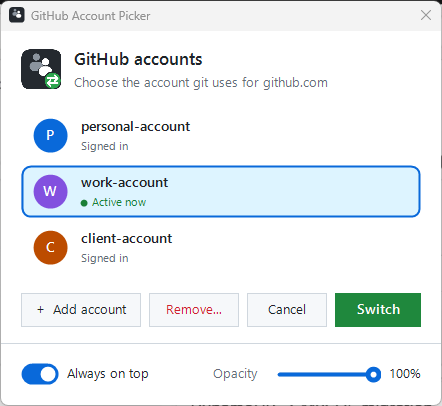

# git-account-picker

Lets you juggle multiple GitHub accounts on one machine without git
silently using the wrong one. Day to day it's quiet: git operations on
`github.com` / `gist.github.com` just use whichever `gh` account is
currently active — no prompt on every command. You only get asked to pick
an account when:

- a git operation actually fails because the active account is wrong for
  that repo (git rejects the credential, calls our helper's `erase` hook,
  we prompt + switch, then git automatically retries the same command —
  so the *next* attempt succeeds with no extra step from you),
- the active account's token turns out to be expired, revoked, or blocked
  by org SSO re-authorization — checked against the real API on `get`,
  throttled to once a minute per host so it doesn't add a network round
  trip to every single git command, only enough to catch this within
  about 60 seconds instead of failing silently forever, or
- you deliberately ask, via the **desktop shortcut** or by running
  `git-switch-account.sh` yourself.



**Adding another account:** every prompt has an **Add account...** entry —
a button in the Windows popup, a list entry in the macOS/Linux popups, and
`a` in the terminal menu. It runs the browser sign-in
(`gh auth login --web --scopes workflow`), refreshes the list, and asks
again so the new account can be picked straight away. The desktop shortcut
always shows the list, even with a single account, so this stays
reachable. Tip: if your browser is already signed in to GitHub as a
different user, sign out or use a private window first, otherwise GitHub
will re-use that session.

The prompt itself, whichever triggers it:

- **Terminal git usage** (plain shell, no IDE) -> a numbered menu prints in
  that terminal.
- **IDEs / GUI git clients** (VS Code, JetBrains, GitHub Desktop, etc. —
  anything that spawns git without a real terminal attached) -> a native
  popup instead: WinForms on Windows, `osascript` on macOS, `zenity`/
  `kdialog` on Linux. Setting `GIT_TERMINAL_PROMPT=0` also forces the
  popup.

The account list is read live from `gh auth status` — add or remove
accounts with `gh auth login` / `gh auth logout` and the picker picks it up
automatically, no reconfiguration needed.

It also self-bootstraps:

- **GitHub CLI missing** -> asks "Install it now? [y/N]" (terminal prompt
  or GUI Yes/No dialog, matching whichever prompt mode is active) and, on
  yes, installs the latest version via `winget`/`choco` (Windows), `brew`
  (macOS), or `apt`/`dnf`/`pacman` (Linux).
- **No GitHub account configured at all** -> automatically opens a
  browser sign-in (`gh auth login --web`), in the current terminal if one
  is attached, otherwise in a freshly spawned terminal window, then
  continues once you've completed it.

## Requirements

- [Git](https://git-scm.com/)
- [GitHub CLI](https://cli.github.com/) (`gh`), logged in to each account
  you want to switch between (`gh auth login`, repeat per account)
- `bash` (Git Bash on Windows, native on macOS/Linux)
- GUI fallback only: PowerShell (bundled with Windows), or `zenity`/
  `kdialog` on Linux (macOS uses the built-in `osascript`)

## Install

Pick the entry point for your OS. Both do the same thing underneath —
`install-windows.ps1` just locates the `bash.exe` that ships with Git for
Windows and runs `install.sh` through it, so you don't need to open Git
Bash manually first.

| OS | Run |
|---|---|
| Windows | `.\install-windows.ps1` (double-click, or "Run with PowerShell") |
| macOS / Linux | `./install.sh` |

Pass a different directory as an argument to install elsewhere, e.g.
`./install.sh /opt/git-account-picker` or
`.\install-windows.ps1 -InstallDir D:\tools\git-account-picker`.

Installs to `~/.git-account-picker` by default, points git's
`credential.helper` for `github.com`/`gist.github.com` at it, and creates a
**"Switch GitHub Account" desktop shortcut**.

Double-clicking the shortcut opens the same account picker on demand —
useful for switching accounts before opening an IDE, independent of any
git command:

- Windows: a `.lnk` on your Desktop that runs a WinForms popup directly
  (no Git Bash dependency for the double-click path).
- macOS: a `Switch GitHub Account.command` file on your Desktop.
- Linux: a `switch-github-account.desktop` launcher on your Desktop.

It can also be run from a terminal directly:

```bash
~/.git-account-picker/bin/git-switch-account.sh
```

## Uninstall

| OS | Run |
|---|---|
| Windows | `.\uninstall-windows.ps1` |
| macOS / Linux | `./uninstall.sh` |

Removes the credential helper config it added, deletes the desktop
shortcut, and deletes the installed copy. Your normal `credential.helper`
(e.g. Git Credential Manager) and your `gh` login sessions are left alone.

## How it works

Git calls the configured credential helper's `get`/`store`/`erase` hooks
as it needs auth for a host. This helper:

1. On `get`: normally just passes straight through to
   `gh auth git-credential get`, which returns whatever account is
   currently active — no prompt. First, though (throttled to once per
   `GIT_ACCOUNT_PICKER_VALIDATE_TTL` seconds, default 60), it runs `gh api user`
   against the real API to make sure the active account's token is
   actually still good. If it isn't, it prompts you to pick an account,
   switches (`gh auth switch`), and — if the newly-active one is *also*
   dead — falls back to a fresh browser sign-in (`gh auth login --web`)
   instead of leaving you with a still-broken credential.
2. On `erase` (git calls this when the server rejects a credential it just
   tried with an HTTP 401 — wrong account for this repo): same
   prompt-then-switch-then-validate flow as above. git retries the
   original `get` automatically within the same operation right after
   `erase`, so the *next* attempt succeeds with no extra step from you.
3. `store` is passed through unchanged.

Why both `get`-time validation and `erase` exist: git only calls `erase`
on a 401. Some real failures never produce that — e.g. org SSO
re-authorization being required shows up as a 403, which git does not
treat as a credential rejection at all, so nothing would ever prompt you
without the proactive check.

The manual desktop-shortcut path (`git-switch-account.sh` /
`switch-account.ps1`) skips all of that and just prompts directly, any
time you want to switch proactively — and validates the result the same
way, falling back to a browser sign-in if the account you picked also
turns out to be dead.

## Limitations

- Only covers `github.com` and `gist.github.com` — other hosts keep using
  your existing `credential.helper`.
- Depends on `gh auth switch`, so it only works with accounts you've
  logged into via `gh auth login`.
- The GUI fallback needs `powershell.exe` (Windows), `osascript` (macOS,
  built in), or `zenity`/`kdialog` (Linux). If none is available (and
  there's no terminal), it keeps the active account and prints a message
  saying so, rather than blocking the git operation or guessing an
  account. Cancelling the picker also keeps the active account.
- The expired-token check adds one `gh api user` call per host at most
  once every `GIT_ACCOUNT_PICKER_VALIDATE_TTL` seconds (default 60) — a token that
  dies mid-window can still fail once silently before the next check
  catches it. Its cache lives at `~/.cache/git-account-picker/`.

## Contributing & license

Open source under the [MIT License](LICENSE). Changes are accepted **only
via pull request** — see [CONTRIBUTING.md](CONTRIBUTING.md). Testing on
macOS and Linux is especially welcome.
