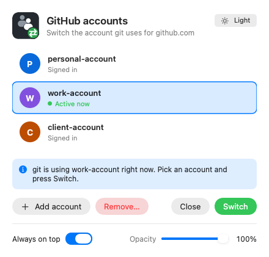
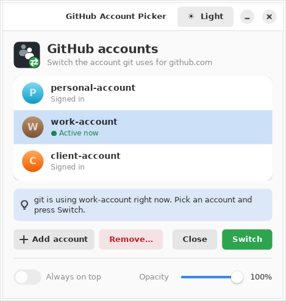

# git-account-picker

Lets you juggle multiple GitHub accounts on one machine without git
silently using the wrong one. Day to day it's quiet: git operations on
`github.com` / `gist.github.com` just use whichever `gh` account is
currently active — no prompt on every command. You only get asked to pick
an account when:

- a git operation actually fails because the active account is wrong for
  that repo (git rejects the credential, calls our helper's `erase` hook,
  we prompt + switch, then git automatically retries the same command —
  so the *next* attempt succeeds with no extra step from you),
- the active account's token turns out to be expired, revoked, or blocked
  by org SSO re-authorization — checked against the real API on `get`,
  throttled to once a minute per host so it doesn't add a network round
  trip to every single git command, only enough to catch this within
  about 60 seconds instead of failing silently forever, or
- you deliberately ask, via the **desktop shortcut** or by running
  `git-switch-account.sh` yourself.






**The picker window** (Windows, macOS and Linux) marks the account git is
using right now as **Active now**; double-click an account to switch to
it. The **theme button** (top right) cycles **Auto → Light → Dark**: Auto
follows your system's light/dark setting (or
`GIT_ACCOUNT_PICKER_THEME=light|dark`), Light and Dark always use that
look.

On macOS the window is a native app the installer builds with the Swift
compiler from the Xcode Command Line Tools (git on macOS already needs
them). Without them — or with `GIT_ACCOUNT_PICKER_NO_NATIVE=1` — it falls
back to the standard macOS dialogs; run `xcode-select --install` and the
installer again to get the window.

On Linux the window uses GTK 4 and libadwaita for Python, preinstalled on
recent GNOME desktops (Fedora; on Ubuntu/Debian
`sudo apt install python3-gi gir1.2-gtk-4.0 gir1.2-adw-1`, Fedora
`sudo dnf install python3-gobject gtk4 libadwaita`). Without them it falls
back to the standard `zenity`/`kdialog` dialogs.

Opened from the **desktop shortcut** (or the macOS / Linux app), it **stays open**: switching, adding
and removing happen in place, a message strip says how each went, and it
closes only when you press **Close** (or the window's ×). When git itself
asks (e.g. during a push from your IDE), it closes as soon as you choose,
because git is waiting for the answer. Confirmations such as "Remove
account" use the same look. At the bottom:

- **Always on top** keeps the popup above other windows (on by default).
  Not available on Linux, where desktops don't let apps keep themselves
  on top.
- **Opacity** makes it see-through, from 40% to 100%.

These and the theme are remembered for next time in
`~/.config/git-account-picker/ui-settings`, shared by all three systems.

**Adding another account:** every prompt has an **Add account...** entry —
a button in the Windows popup, a list entry in the macOS/Linux popups, and
`a` in the terminal menu. It opens GitHub's sign-in page
(github.com/login/device) in your browser and shows a one-time code to
enter there (in the terminal, or in a small window — already copied to
your clipboard), then refreshes the list and asks again so the new account
can be picked straight away. Under the hood it runs
`gh auth login --web --scopes workflow` without letting gh ask questions:
gh's own "Authenticate Git with your GitHub credentials?" would replace
this tool's git setup if answered yes. The desktop shortcut
always shows the list, even with a single account, so this stays
reachable. Tip: if your browser is already signed in to GitHub as a
different user, sign out or use a private window first, otherwise GitHub
will re-use that session.

**Removing an account:** every prompt also has **Remove account...** — a
**Remove...** button in the Windows popup, a list entry in the
macOS/Linux popups, and `r` in the terminal menu. After you confirm, it
signs that account out of this computer (`gh auth logout`), drops it from
the list, and forgets any repo owners remembered for it. **Your GitHub
account itself is not deleted** — add it back any time with **Add
account...**.

### Remembering accounts

Once you pick an account for a repo **owner** (the user or organization in
`github.com/<owner>/<repo>`), the picker remembers it. Next time git talks
to any repo of that owner, it switches to the remembered account
automatically, with no prompt. So mixing personal and work repos asks
once per owner, not every time you change repos.

It learns by itself: whenever a git operation that needs your sign-in
(a push, or a fetch of a private repo) **succeeds**, the account that
worked is remembered for that repo's owner. So the usual routine is:

1. The first time you work with an owner, switch to the right account as
   you do today (desktop shortcut, popup or terminal menu), then push or
   pull. You'll see `will use '<account>' for <owner> from now on`.
2. From then on, git switches to that account automatically for that
   owner's repos, even after you've switched away for another owner.

Fetching a *public* repo needs no sign-in, so it doesn't teach it
anything. You can also teach it directly by running `git-switch-account.sh`
from a terminal **inside a clone** of a github.com repo.

```bash
~/.git-account-picker/bin/git-switch-account.sh --list            # what's remembered
~/.git-account-picker/bin/git-switch-account.sh --forget my-company # undo one
```

Remembered choices live in `~/.config/git-account-picker/owners` (one
`owner account` per line). Set `GIT_ACCOUNT_PICKER_REMEMBER=0` to turn the
feature off. It needs git to tell the picker which repo it's talking to,
which `install.sh` turns on with
`git config --global credential.https://github.com.useHttpPath true`. If
you installed an earlier version, run the installer again to enable it.

The prompt itself, whichever triggers it:

- **Terminal git usage** (plain shell, no IDE) -> a numbered menu prints in
  that terminal.
- **IDEs / GUI git clients** (VS Code, JetBrains, GitHub Desktop, etc. —
  anything that spawns git without a real terminal attached) -> a native
  popup instead: WinForms on Windows, the native window on macOS (or
  `osascript` dialogs without it), the native window on Linux (or
  `zenity`/`kdialog` without it). Setting
  `GIT_TERMINAL_PROMPT=0` also forces the popup.

The account list is read live from `gh auth status` — add or remove
accounts with `gh auth login` / `gh auth logout` and the picker picks it up
automatically, no reconfiguration needed.

It also self-bootstraps:

- **GitHub CLI missing** -> asks "Install it now? [y/N]" (terminal prompt
  or GUI Yes/No dialog, matching whichever prompt mode is active) and, on
  yes, installs the latest version via `winget`/`choco` (Windows), `brew`
  (macOS), or `apt`/`dnf`/`pacman` (Linux).
- **No GitHub account configured at all** -> automatically opens a
  browser sign-in (`gh auth login --web`), in the current terminal if one
  is attached, otherwise in a freshly spawned terminal window, then
  continues once you've completed it.

## Requirements

- [Git](https://git-scm.com/)
- [GitHub CLI](https://cli.github.com/) (`gh`), logged in to each account
  you want to switch between (`gh auth login`, repeat per account)
- `bash` (Git Bash on Windows, native on macOS/Linux)
- GUI fallback only: PowerShell (bundled with Windows), or `zenity`/
  `kdialog` on Linux (macOS uses the built-in `osascript`)

## Install

No need to clone anything. Paste one line — it downloads the latest
release, runs its installer, and cleans up after itself. Running it again
later updates you to the newest release.

**Windows** (in PowerShell):

```powershell
irm https://github.com/sombirverma/git-account-picker/releases/latest/download/get-git-account-picker.ps1 | iex
```

**macOS / Linux** (in Terminal):

```bash
curl -fsSL https://github.com/sombirverma/git-account-picker/releases/latest/download/get-git-account-picker.sh | bash
```

Prefer to look before you run? Download **`git-account-picker.zip`** (or
`.tar.gz`) from the [latest release](https://github.com/sombirverma/git-account-picker/releases/latest),
extract it, and run the installer for your OS from inside the folder:

| OS | Run |
|---|---|
| Windows | `.\install-windows.ps1` (double-click, or "Run with PowerShell") |
| macOS / Linux | `bash install.sh` |

Both do the same thing underneath — `install-windows.ps1` just locates the
`bash.exe` that ships with Git for Windows and runs `install.sh` through
it, so you don't need to open Git Bash manually first.

Pass a different directory as an argument to install elsewhere, e.g.
`bash install.sh /opt/git-account-picker` or
`.\install-windows.ps1 -InstallDir D:\tools\git-account-picker`.

Installs to `~/.git-account-picker` by default, points git's
`credential.helper` for `github.com`/`gist.github.com` at it, turns on
`credential.https://github.com.useHttpPath` (so it can
[remember accounts](#remembering-accounts) per owner), and creates a
**"Switch GitHub Account" desktop shortcut**.

Double-clicking the shortcut opens the same account picker on demand —
useful for switching accounts before opening an IDE, independent of any
git command:

- Windows: a `.lnk` on your Desktop that runs a WinForms popup directly
  (no Git Bash dependency for the double-click path).
- macOS: a **Switch GitHub Account** app in your `~/Applications` folder —
  find it in **Launchpad** or **Spotlight** (⌘ Space, "Switch GitHub") and
  drag it to the Dock to keep it handy — plus a shortcut to it on your
  Desktop. (Newer macOS can hide Desktop items: System Settings → Desktop &
  Dock → "Show Items".) Installing replaces the plain
  `Switch GitHub Account.command` script that earlier versions put there.
- Linux: **Switch GitHub Account** in your applications menu (search for
  it), plus a launcher on your Desktop.

The shortcuts and the macOS app use the tool's icon — two people (your
accounts) with a green switch badge (`gui/icon.ico` / `gui/icon.png`,
drawn by `tools/make-icon.ps1`).

It can also be run from a terminal directly:

```bash
~/.git-account-picker/bin/git-switch-account.sh
```

## Uninstall

The installer keeps the uninstallers in the install folder, so this works
however you installed:

| OS | Run |
|---|---|
| Windows (PowerShell) | `& "$HOME\.git-account-picker\uninstall-windows.ps1"` |
| macOS / Linux | `bash ~/.git-account-picker/uninstall.sh` |

Removes the credential helper and `useHttpPath` config it added, deletes
the desktop shortcut, and deletes the installed copy. Remembered accounts
in `~/.config/git-account-picker/` are kept, in case you reinstall. Your normal `credential.helper`
(e.g. Git Credential Manager) and your `gh` login sessions are left alone.

## How it works

Git calls the configured credential helper's `get`/`store`/`erase` hooks
as it needs auth for a host. This helper:

1. On `get`: if an account is remembered for the repo's owner and it
   isn't the active one, switches to it (`gh auth switch`). Then it passes
   straight through to `gh auth git-credential get`, which returns
   whatever account is currently active — no prompt. First, though (throttled to once per
   `GIT_ACCOUNT_PICKER_VALIDATE_TTL` seconds, default 60), it runs `gh api user`
   against the real API to make sure the active account's token is
   actually still good. If it isn't, it prompts you to pick an account,
   switches (`gh auth switch`), and — if the newly-active one is *also*
   dead — falls back to a fresh browser sign-in (`gh auth login --web`)
   instead of leaving you with a still-broken credential.
2. On `erase` (git calls this when the server rejects a credential it just
   tried with an HTTP 401 — wrong account for this repo): same
   prompt-then-switch-then-validate flow as above, and the account you
   pick is remembered for that repo's owner. git retries the
   original `get` automatically within the same operation right after
   `erase`, so the *next* attempt succeeds with no extra step from you.
3. On `store` (git calls this after the server *accepted* a credential):
   remembers the account that worked for the repo's owner, then passes
   through to `gh auth git-credential store`.

Why both `get`-time validation and `erase` exist: git only calls `erase`
on a 401. Some real failures never produce that — e.g. org SSO
re-authorization being required shows up as a 403, which git does not
treat as a credential rejection at all, so nothing would ever prompt you
without the proactive check.

The manual desktop-shortcut path (`git-switch-account.sh` /
`switch-account.ps1`) skips all of that and just prompts directly, any
time you want to switch proactively — and validates the result the same
way, falling back to a browser sign-in if the account you picked also
turns out to be dead.

## Limitations

- Only covers `github.com` and `gist.github.com` — other hosts keep using
  your existing `credential.helper`.
- Depends on `gh auth switch`, so it only works with accounts you've
  logged into via `gh auth login`.
- The GUI fallback needs `powershell.exe` (Windows), `osascript` (macOS,
  built in), or `zenity`/`kdialog` (Linux). If none is available (and
  there's no terminal), it keeps the active account and prints a message
  saying so, rather than blocking the git operation or guessing an
  account. Cancelling the picker also keeps the active account.
- The expired-token check adds one `gh api user` call per host at most
  once every `GIT_ACCOUNT_PICKER_VALIDATE_TTL` seconds (default 60) — a token that
  dies mid-window can still fail once silently before the next check
  catches it. Its cache lives at `~/.cache/git-account-picker/`.

## Contributing & license

Open source under the [MIT License](LICENSE). Changes are accepted **only
via pull request** — see [CONTRIBUTING.md](CONTRIBUTING.md). Testing on
macOS and Linux is especially welcome.
